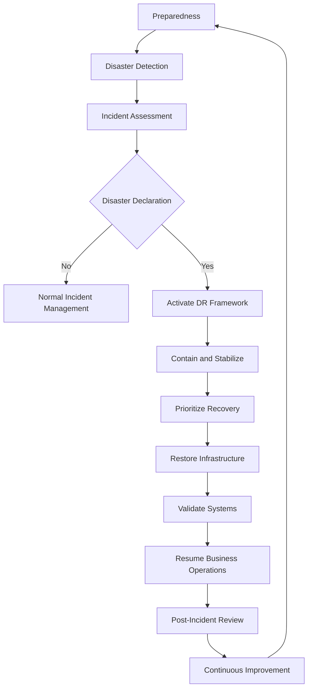
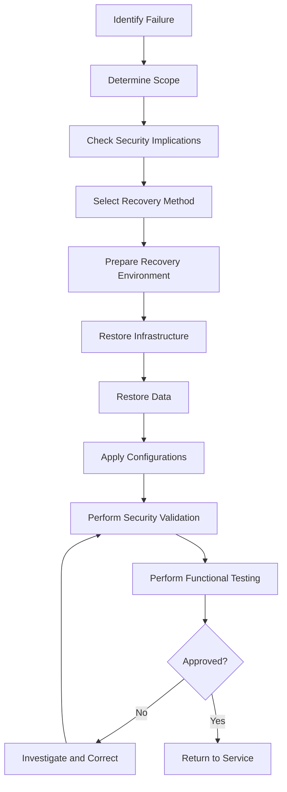
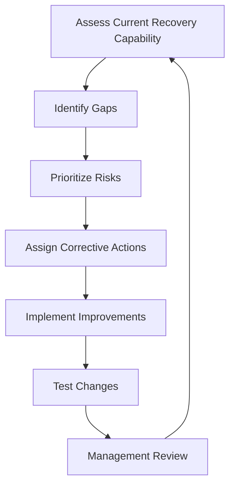

# Enterprise Disaster Recovery & Business Continuity Framework

**Repository:** `enterprise-disaster-recovery-framework`  
**Document:** Enterprise Disaster Recovery Framework  
**Version:** 2.0  
**Owner:** IT Department  
**Classification:** Internal / Confidential  
**Status:** Framework Template - Pending Organizational Approval  
**Review Cycle:** Annual and following significant incidents or infrastructure changes

---

# Table of Contents

1. Executive Summary
2. Purpose and Objectives
3. Scope and Applicability
4. Framework Architecture
5. Governance and Management
6. Roles and Responsibilities
7. Risk Management and Assessment
8. Business Impact Analysis (BIA)
9. Recovery Objectives (RTO, RPO, MTPD)
10. Business and IT Service Classification
11. Infrastructure Inventory and Dependencies
12. Disaster Recovery Strategies
13. Backup and Data Protection Requirements
14. Incident Classification and Disaster Declaration
15. Crisis Management and Communications
16. Disaster Recovery Activation Procedures
17. Technical Recovery Procedures
18. Cybersecurity and Ransomware Recovery
19. Infrastructure Recovery Procedures
20. Cloud and Hybrid Infrastructure Recovery
21. Third-Party and Vendor Dependencies
22. Business Continuity Procedures
23. Disaster Recovery Testing and Exercises
24. Recovery Validation and Service Restoration
25. Post-Incident Review
26. Monitoring, Reporting and Performance Metrics
27. Documentation and Evidence Management
28. Training and Awareness
29. Compliance and Audit Requirements
30. Continuous Improvement
31. Implementation Roadmap
32. Recovery Checklists
33. Document Approval and Revision History
34. Standards and References

---

# 1. Executive Summary

## 1.1 Overview

This framework establishes an enterprise-wide approach to Disaster Recovery (DR) and Business Continuity Management (BCM).

Its purpose is to ensure that the organization can prepare for, respond to, recover from, and resume operations following events that disrupt critical business functions or information technology infrastructure.

The framework integrates people, processes, technology, facilities, third-party services, and organizational governance into a coordinated recovery strategy.

## 1.2 Business Objectives

The organization aims to:

- Protect critical business information.
- Maintain availability of essential business services.
- Minimize operational downtime.
- Reduce financial and reputational damage.
- Protect infrastructure against cyber threats.
- Maintain reliable and recoverable backups.
- Establish clear emergency responsibilities.
- Restore systems within approved recovery objectives.
- Maintain regulatory and contractual obligations.
- Improve organizational resilience.

## 1.3 Recovery Principles

The organization shall follow these principles:

1. Protect human safety before technical recovery.
2. Protect the confidentiality, integrity, and availability of information.
3. Prioritize recovery according to business impact.
4. Maintain independent and secure recovery capabilities.
5. Validate recovered systems before returning them to production.
6. Maintain documented and tested recovery procedures.
7. Establish clear management authority during major incidents.
8. Review and improve recovery capabilities continuously.

---

# 2. Purpose and Objectives

## 2.1 Purpose

The purpose of the Disaster Recovery Framework is to establish a standardized approach for managing major disruptions.

The framework provides guidance for:

- Disaster preparedness.
- Risk identification.
- Business impact analysis.
- Recovery planning.
- Incident response.
- Infrastructure restoration.
- Business continuity.
- Recovery testing.
- Management oversight.

## 2.2 Expected Outcomes

The organization should be able to:

- Identify critical systems and business processes.
- Understand infrastructure dependencies.
- Determine acceptable downtime.
- Recover business data.
- Restore network and identity services.
- Recover applications and databases.
- Maintain alternative business operations.
- Validate system integrity.
- Communicate effectively during emergencies.

## 2.3 Success Criteria

A disaster recovery program is successful when:

- Recovery procedures are documented.
- Recovery responsibilities are assigned.
- Critical infrastructure is inventoried.
- Recovery objectives are approved.
- Backup copies are available and verified.
- Recovery tests are completed.
- Recovery objectives are measured.
- Management reviews recovery results.
- Corrective actions are tracked to completion.

---

# 3. Scope and Applicability

## 3.1 Organizational Scope

This framework applies to:

- Executive management.
- IT infrastructure.
- Network operations.
- Cybersecurity.
- Application support.
- Database administration.
- Cloud administration.
- Business departments.
- External service providers.

## 3.2 Technology Scope

The framework covers:

| Technology | Coverage |
|---|---|
| Physical Servers | Hardware and operating system recovery |
| VMware | Hypervisors and virtual machines |
| Veeam | Backup and restoration |
| Microsoft Azure | Cloud infrastructure recovery |
| Microsoft 365 | Email and collaboration recovery |
| Active Directory | On-premises identity recovery |
| Microsoft Entra ID | Cloud identity recovery |
| SQL Server | Database recovery |
| File Servers | File and permission recovery |
| Cisco Meraki | Network and configuration recovery |
| Firewalls | Network security restoration |
| VPN | Remote access restoration |
| Endpoints | Employee device recovery |
| SaaS Applications | External application continuity |

## 3.3 Exclusions

The following activities may be covered by separate specialized plans:

- Physical building evacuation.
- Workplace emergency response.
- Fire suppression procedures.
- Occupational health and safety.
- Specialized industrial control systems.

These plans must coordinate with the organization's broader continuity framework.

---

# 4. Framework Architecture

## 4.1 Management Architecture

The framework is divided into five operational layers.

| Layer | Responsibility |
|---|---|
| Governance | Policies, management authority and approval |
| Risk Management | Threat identification and mitigation |
| Business Continuity | Maintain essential business operations |
| IT Disaster Recovery | Restore infrastructure and technology |
| Validation and Improvement | Test recovery and improve procedures |

## 4.2 Recovery Lifecycle



## 4.3 Recovery Phases

### Phase 1: Preparedness

- Maintain recovery documentation.
- Inventory infrastructure.
- Maintain secure backups.
- Establish emergency contacts.
- Conduct risk assessments.
- Train recovery personnel.

### Phase 2: Detection and Assessment

- Identify the incident.
- Determine the scope.
- Assess business impact.
- Classify severity.
- Notify relevant stakeholders.

### Phase 3: Containment

- Isolate affected infrastructure.
- Protect unaffected systems.
- Secure backup environments.
- Preserve forensic evidence.
- Prevent additional damage.

### Phase 4: Recovery

- Activate recovery infrastructure.
- Restore critical systems.
- Recover data.
- Re-establish connectivity.
- Validate services.

### Phase 5: Business Resumption

- Obtain business owner approval.
- Restore normal operational processes.
- Monitor system performance.
- Communicate recovery status.

### Phase 6: Improvement

- Document lessons learned.
- Review recovery objectives.
- Identify weaknesses.
- Assign corrective actions.

---

# 5. Governance and Management

## 5.1 Governance Requirements

The organization must establish formal governance for disaster recovery.

Governance must define:

- Policy ownership.
- Management authority.
- Recovery funding.
- Risk acceptance.
- Recovery objectives.
- Testing requirements.
- Reporting requirements.
- Compliance responsibilities.

## 5.2 Policy Hierarchy

The following documents should support the framework.

| Document | Purpose |
|---|---|
| Enterprise DR Framework | Overall management structure |
| Disaster Recovery Policy | Mandatory recovery requirements |
| Business Continuity Policy | Continuation of business operations |
| Backup Policy | Data protection requirements |
| Incident Response Policy | Security incident management |
| Crisis Management Plan | Executive emergency management |
| Disaster Recovery Plan | Organization-specific recovery instructions |
| Technical Runbooks | Detailed technical recovery steps |

## 5.3 Policy Review

The framework must be reviewed:

- Annually.
- After major infrastructure changes.
- Following significant security incidents.
- Following disaster recovery exercises.
- When business recovery objectives change.
- When regulatory obligations change.

## 5.4 Management Approval

Management must approve:

- Disaster Recovery Policy.
- Recovery objectives.
- Recovery strategies.
- Recovery funding.
- Disaster declaration authority.
- Annual recovery testing program.

---

# 6. Roles and Responsibilities

## 6.1 Disaster Recovery Management Team

| Role | Responsibilities |
|---|---|
| Executive Sponsor | Provides strategic authority and funding |
| Crisis Manager | Coordinates major incident decisions |
| DR Coordinator | Coordinates recovery activities |
| IT Manager | Directs technical recovery |
| Systems Administrator | Restores servers and systems |
| Network Administrator | Restores network infrastructure |
| Database Administrator | Recovers databases |
| Cybersecurity Lead | Investigates and contains threats |
| Application Owner | Validates application functionality |
| Business Manager | Approves business service restoration |
| Communications Lead | Coordinates internal and external updates |
| Vendor Coordinator | Manages third-party recovery support |

## 6.2 Responsibility Matrix

RACI definitions:

- R = Responsible
- A = Accountable
- C = Consulted
- I = Informed

| Activity | Executive | IT Manager | IT Team | Security | Business |
|---|---|---|---|---|---|
| Approve DR Policy | A | R | I | C | C |
| Conduct Risk Assessment | I | A | R | R | C |
| Perform BIA | I | C | C | C | A/R |
| Declare Major Disaster | A | R | I | C | I |
| Restore Infrastructure | I | A | R | C | I |
| Contain Cyberattack | I | C | R | A | I |
| Validate Applications | I | C | C | C | A/R |
| Approve Business Resumption | A | C | I | C | R |
| Review DR Testing | I | A | R | C | C |

The organization must formally assign individuals to these roles and define backup personnel.

---

# 7. Risk Management and Assessment

## 7.1 Risk Assessment Methodology

Risk assessments must identify events that could disrupt business operations.

For each risk, evaluate:

1. Threat source.
2. Vulnerability.
3. Likelihood.
4. Business impact.
5. Existing controls.
6. Residual risk.
7. Mitigation strategy.
8. Risk owner.

## 7.2 Threat Register

| Threat | Likelihood | Impact | Risk |
|---|---|---|---|
| Ransomware | High | Critical | Critical |
| Hardware Failure | Medium | High | High |
| Datacenter Outage | Low | Critical | High |
| Power Failure | Medium | High | High |
| Human Error | Medium | High | High |
| Network Outage | Medium | High | High |
| Cloud Service Failure | Medium | High | High |
| Insider Threat | Low | Critical | High |
| Fire / Flood | Low | Critical | High |
| Third-Party Failure | Medium | Medium | Medium |

These ratings are illustrative. Actual risk ratings must be established using the organization's threat intelligence and risk assessment methodology.

## 7.3 Risk Scoring

Example scoring methodology:

Likelihood:

| Score | Description |
|---|---|
| 1 | Rare |
| 2 | Unlikely |
| 3 | Possible |
| 4 | Likely |
| 5 | Almost Certain |

Impact:

| Score | Description |
|---|---|
| 1 | Negligible |
| 2 | Minor |
| 3 | Moderate |
| 4 | Major |
| 5 | Severe |

Risk Score:

Risk Score = Likelihood × Impact

| Score | Risk Level |
|---|---|
| 1–4 | Low |
| 5–9 | Medium |
| 10–16 | High |
| 17–25 | Critical |

## 7.4 Risk Treatment

Four primary risk treatment options:

- Mitigate: Implement controls to reduce risk.
- Avoid: Eliminate the activity creating the risk.
- Transfer: Transfer certain financial consequences through insurance or contractual arrangements.
- Accept: Formally accept residual risk through authorized management.

Risk acceptance must be documented and approved by the appropriate authority.

---

# 8. Business Impact Analysis (BIA)

## 8.1 Purpose

The Business Impact Analysis determines how disruptions affect the organization.

The BIA identifies:

- Critical business processes.
- Required technology.
- Required personnel.
- Financial impact.
- Operational impact.
- Legal obligations.
- Customer impact.
- Maximum tolerable downtime.

## 8.2 BIA Methodology

### Step 1: Identify Business Processes

Work with department managers to identify essential operations.

Examples:

- Customer service.
- Manufacturing operations.
- Finance.
- Human resources.
- Engineering.
- Sales.
- Supply chain.
- Information technology.

### Step 2: Identify Dependencies

For each process, identify:

- Supporting applications.
- Databases.
- Servers.
- Network services.
- Cloud services.
- Employees.
- Vendors.
- Facilities.
- External integrations.

### Step 3: Evaluate Business Impact

Evaluate the impact of disruptions at different intervals.

| Downtime | Potential Impact |
|---|---|
| 0–4 Hours | Temporary productivity loss |
| 4–8 Hours | Operational delays |
| 8–24 Hours | Significant business disruption |
| 24–72 Hours | Financial and customer impact |
| More than 72 Hours | Potential severe business consequences |

Actual impact thresholds must be established with business stakeholders.

### Step 4: Determine Criticality

| Classification | Description |
|---|---|
| Critical | Immediate or very rapid recovery required |
| High | Recovery required within an approved short window |
| Medium | Temporary disruption is manageable |
| Low | Recovery can be deferred |

### Step 5: Approve Recovery Requirements

Business owners must approve:

- Recovery priority.
- RPO.
- RTO.
- Maximum tolerable downtime.
- Temporary operating procedures.

## 8.3 BIA Template

| Field | Description |
|---|---|
| Department | Business department |
| Business Process | Critical operational function |
| Process Owner | Responsible manager |
| Supporting Application | Required software |
| Infrastructure Dependency | Required IT systems |
| Financial Impact | Estimated financial loss |
| Operational Impact | Operational consequences |
| Customer Impact | Customer service consequences |
| RPO | Maximum acceptable data loss |
| RTO | Required recovery time |
| MTPD | Maximum tolerable disruption |
| Recovery Priority | Criticality |
| Approval | Business owner approval |

---

# 9. Recovery Objectives

## 9.1 Recovery Point Objective (RPO)

RPO defines the maximum acceptable amount of data loss measured in time.

Example:

An RPO of 1 hour means the organization should be able to recover data to a point no more than approximately one hour before the disruption.

RPO determines backup and replication frequency.

## 9.2 Recovery Time Objective (RTO)

RTO defines the maximum acceptable time to restore a business service.

Example:

An RTO of 4 hours means the organization targets restoring the service within four hours of the disruption.

RTO influences:

- Backup infrastructure.
- Recovery automation.
- Standby systems.
- Recovery personnel.
- Vendor support.
- Testing requirements.

## 9.3 Maximum Tolerable Period of Disruption (MTPD)

MTPD represents the maximum period a business process can remain disrupted before the resulting impact becomes unacceptable.

The recovery target must fit within the approved business tolerance.

General relationship:

MTPD > RTO

## 9.4 Recovery Objective Matrix

| Service | RPO | RTO | Priority |
|---|---|---|---|
| Identity Services | 1 Hour | 2 Hours | Critical |
| SQL Database | 15 Minutes | 2 Hours | Critical |
| ERP | 1 Hour | 4 Hours | Critical |
| File Server | 24 Hours | 4 Hours | High |
| Microsoft 365 | 24 Hours | 8 Hours | High |
| SharePoint | 24 Hours | 8 Hours | High |
| Network Infrastructure | Configuration Change-Based | 2 Hours | Critical |
| Workstations | 24 Hours | 24 Hours | Medium |

These are example targets, not guaranteed recovery capabilities.

## 9.5 RTO Calculation

Total recovery time should account for the entire recovery process.

Example:

| Activity | Duration |
|---|---:|
| Incident Assessment | 15 Minutes |
| Recovery Authorization | 15 Minutes |
| Infrastructure Preparation | 30 Minutes |
| Data Restoration | 60 Minutes |
| Configuration | 30 Minutes |
| Validation | 30 Minutes |
| Total | 180 Minutes |

Actual recovery time depends on workload size, storage performance, network capacity, dependencies and personnel availability.

---

# 10. Business and IT Service Classification

## 10.1 Classification Model

Every business service must receive a recovery priority.

### Tier 0 - Foundational Infrastructure

Services required to support other infrastructure.

Examples:

- Network connectivity.
- Identity management.
- DNS.
- Authentication.
- Backup infrastructure.

### Tier 1 - Mission Critical

Services essential to core business operations.

Examples:

- ERP.
- Production databases.
- Manufacturing applications.
- Core business systems.

### Tier 2 - Business Critical

Services required for normal business operations.

Examples:

- File servers.
- Collaboration platforms.
- Department applications.

### Tier 3 - Supporting Services

Services that can tolerate longer outages.

Examples:

- Printing.
- Nonessential reporting.
- Development environments.
- Training systems.

Recovery sequencing must be based on actual dependencies rather than tier labels alone.

---

# 11. Infrastructure Inventory and Dependencies

## 11.1 Infrastructure Inventory

Maintain a centralized inventory of all recoverable assets.

### Physical Infrastructure

- Servers.
- Storage systems.
- Backup appliances.
- UPS.
- Datacenter equipment.

### Virtual Infrastructure

- VMware vCenter.
- ESXi hosts.
- Virtual machines.
- Datastores.
- Virtual switches.
- Resource pools.

### Network Infrastructure

- Routers.
- Switches.
- Firewalls.
- Wireless access points.
- VPN gateways.
- Internet circuits.
- VLANs.
- DNS.
- DHCP.

### Cloud Infrastructure

- Azure subscriptions.
- Resource groups.
- Virtual networks.
- Virtual machines.
- Storage accounts.
- Key Vault dependencies.
- Network Security Groups.
- Backup vaults.

### Identity Infrastructure

- Active Directory.
- Microsoft Entra ID.
- Domain controllers.
- MFA.
- Service accounts.
- Privileged access.
- Identity synchronization.

## 11.2 Dependency Mapping

Example:

```text
Business Application
        |
        v
Application Server
        |
        v
SQL Database
        |
        v
Virtual Machine
        |
        v
VMware Hypervisor
        |
        v
Storage Infrastructure
        |
        v
Network Infrastructure
        |
        v
Identity and DNS Services
```

Document dependencies in both directions:

- What does the system require?
- Which other systems depend on it?

## 11.3 Configuration Documentation

Maintain secure copies of:

- Network configurations.
- Firewall rules.
- VLAN configurations.
- DNS records.
- DHCP scopes.
- Routing information.
- Virtual machine settings.
- Application configuration.
- Cloud deployment templates.

Never place production secrets or credentials in public documentation.

---

# 12. Disaster Recovery Strategies

## 12.1 Recovery Site Strategies

| Strategy | Description | Cost / Recovery Characteristics |
|---|---|---|
| Cold Site | Alternative location without ready infrastructure | Lower cost, slower recovery |
| Warm Site | Partially configured alternative infrastructure | Moderate cost and recovery time |
| Hot Site | Fully operational standby environment | Higher cost, faster recovery |
| Cloud DR | Recover workloads using cloud infrastructure | Depends on architecture and configuration |
| Hybrid DR | Combination of on-premises and cloud recovery | Flexible, requires coordination |

## 12.2 Recovery Methods

### Backup and Restore

Restore systems from verified backup copies.

Suitable for:

- Individual server failures.
- Accidental deletion.
- Database corruption.
- File recovery.

### Replication

Maintain copies of workloads at an alternative location.

Suitable for:

- Critical virtual machines.
- Applications requiring shorter recovery times.
- Infrastructure requiring standby capacity.

Replication is not a replacement for independent backups because corrupted or encrypted data may also replicate.

### Infrastructure as Code

Use templates and automation to redeploy infrastructure.

Examples:

- Terraform.
- Azure Bicep.
- ARM templates.
- PowerShell.
- Ansible.

### Manual Recovery

Use documented procedures when automated recovery is unavailable.

---

# 13. Backup and Data Protection Requirements

## 13.1 Backup Strategy

The organization should implement the 3-2-1-1-0 strategy.

- 3 copies of data.
- 2 different storage types.
- 1 offsite copy.
- 1 immutable or offline copy.
- 0 unverified backup errors.

## 13.2 Backup Scope

| Asset | Backup Requirement |
|---|---|
| Virtual Machines | VM-level backup |
| SQL Databases | Full, differential and transaction logs |
| File Servers | File and permission protection |
| Microsoft 365 | Independent data protection where required |
| Network Devices | Configuration backups |
| Cloud Resources | Configuration and data protection |
| Active Directory | System State and forest recovery capability |
| Application Configurations | Secure configuration backups |

## 13.3 Retention Policy

Example:

| Backup Type | Frequency | Retention |
|---|---|---|
| Incremental | Daily | 30 Days |
| Full | Weekly | 4 Weeks |
| Monthly | Monthly | 12 Months |
| Annual Archive | Yearly | 7 Years, where required |

Retention must be based on legal, contractual and operational requirements.

## 13.4 Backup Security

- Restrict administrative access.
- Implement MFA.
- Encrypt backup data.
- Maintain immutable copies.
- Separate backup credentials.
- Monitor backup deletion activities.
- Test restoration regularly.
- Protect encryption keys.
- Maintain offline or isolated recovery options.

---

# 14. Incident Classification and Disaster Declaration

## 14.1 Incident Severity

| Severity | Classification | Description |
|---|---|---|
| SEV 1 | Critical | Major business disruption |
| SEV 2 | High | Critical service unavailable |
| SEV 3 | Medium | Limited operational disruption |
| SEV 4 | Low | Minor technical issue |

## 14.2 Disaster Declaration Criteria

A disaster declaration should be considered when:

- Multiple critical services are unavailable.
- Primary datacenter operations are disrupted.
- Critical infrastructure is compromised.
- Recovery cannot be completed through normal incident management.
- Business operations exceed approved downtime tolerances.
- A major security incident requires alternate infrastructure.

## 14.3 Disaster Declaration Process

1. Incident detected.
2. Incident commander assigned.
3. Business impact assessed.
4. Severity classified.
5. Relevant stakeholders notified.
6. Recovery options evaluated.
7. Authorized management declares disaster.
8. Disaster Recovery Plan activated.
9. Recovery teams mobilized.
10. Recovery activities tracked.

---

# 15. Crisis Management and Communications

## 15.1 Communication Objectives

Maintain reliable communication during an incident.

Communications must address:

- What happened?
- Which services are affected?
- What is the business impact?
- What actions are underway?
- What temporary arrangements are available?
- When will the next update occur?

## 15.2 Communication Channels

Primary channels:

- Corporate email.
- Microsoft Teams.
- Telephone.
- IT service management platform.

Alternative channels:

- Emergency telephone numbers.
- Independent communication platform.
- Approved external notification service.
- Offline contact directory.

The alternative communication channel must not depend entirely on the infrastructure being recovered.

## 15.3 Communication Schedule

Example:

| Incident Severity | Update Frequency |
|---|---|
| SEV 1 | Every 30–60 minutes |
| SEV 2 | Every 2 hours |
| SEV 3 | Every 4 hours |
| SEV 4 | According to normal incident procedures |

## 15.4 Communication Template

```text
Subject: Disaster Recovery Activation - [Incident ID]

Incident:
[Incident description]

Date and Time:
[Detection time]

Severity:
[SEV 1 / SEV 2 / SEV 3]

Affected Services:
[List affected systems]

Business Impact:
[Describe operational impact]

Actions Taken:
[Containment and recovery actions]

Current Status:
[Investigation / Recovery / Validation]

Next Update:
[Date and time]

Incident Coordinator:
[Authorized contact]
```

---

# 16. Disaster Recovery Activation Procedures

## 16.1 Activation Checklist

- [ ] Confirm incident.
- [ ] Assess impact.
- [ ] Identify affected business services.
- [ ] Determine incident severity.
- [ ] Notify management.
- [ ] Assign incident commander.
- [ ] Obtain disaster declaration where required.
- [ ] Activate recovery team.
- [ ] Establish communication channels.
- [ ] Secure unaffected infrastructure.
- [ ] Identify recovery environment.
- [ ] Identify clean recovery points.
- [ ] Begin prioritized recovery.

## 16.2 Recovery Command Structure

The recovery team should establish:

- Incident commander.
- Technical recovery lead.
- Security lead.
- Communications lead.
- Business representative.
- Vendor liaison.

Each team must maintain a record of decisions, approvals, timestamps and recovery activities.

---

# 17. Technical Recovery Procedures

## 17.1 General Recovery Workflow



## 17.2 General Recovery Requirements

Before restoring any critical service:

- Verify authorization.
- Verify the recovery point.
- Check backup integrity.
- Confirm infrastructure dependencies.
- Confirm network availability.
- Confirm identity dependencies.
- Verify security controls.
- Document recovery progress.

---

# 18. Cybersecurity and Ransomware Recovery

## 18.1 Objectives

Protect the organization from further damage and recover infrastructure safely.

## 18.2 Immediate Response

1. Activate the cybersecurity incident response process.
2. Isolate compromised endpoints and servers.
3. Protect backup infrastructure.
4. Disable or restrict compromised accounts.
5. Preserve forensic evidence.
6. Identify affected network segments.
7. Assess the scope of compromise.
8. Notify authorized management.
9. Engage external specialists where required.

Do not automatically power off infected systems. Coordinate containment with incident responders to preserve evidence and prevent further damage.

## 18.3 Recovery Preparation

Before restoring:

- Identify the initial compromise.
- Determine whether administrative accounts are compromised.
- Review backup repository security.
- Identify clean recovery points.
- Verify backup integrity.
- Prepare clean recovery infrastructure.
- Patch exploited vulnerabilities.
- Rotate compromised credentials.
- Validate identity security.

## 18.4 Recovery Sequence

1. Establish clean administrative access.
2. Recover foundational network services.
3. Recover identity services.
4. Recover security monitoring.
5. Recover databases.
6. Recover critical applications.
7. Recover file services.
8. Recover endpoints.
9. Validate all systems.
10. Monitor for reinfection.

The sequence must be adjusted based on the attack and actual dependencies.

## 18.5 Post-Ransomware Validation

- [ ] No known active malware remains.
- [ ] Compromised accounts have been secured.
- [ ] Privileged credentials have been reviewed.
- [ ] Systems are patched.
- [ ] Backup integrity is verified.
- [ ] Security monitoring is operational.
- [ ] Network segmentation is validated.
- [ ] Business applications are functional.
- [ ] Incident evidence is preserved.

---

# 19. Infrastructure Recovery Procedures

## 19.1 VMware Recovery

Recovery requirements:

- vCenter availability.
- ESXi host availability.
- Datastore availability.
- Network connectivity.
- VM configuration.
- Backup repository access.

Recovery procedure:

1. Assess the failed VMware component.
2. Determine whether host replacement is required.
3. Verify vCenter and storage availability.
4. Select a valid VM restore point.
5. Restore the VM.
6. Validate virtual networking.
7. Verify operating system startup.
8. Validate application services.
9. Obtain service-owner approval.

## 19.2 Veeam Recovery

Recovery requirements:

- Veeam backup server.
- Backup repository.
- Configuration backup.
- Encryption credentials.
- Repository access.
- Backup catalog and restore points.

Recovery procedure:

1. Verify backup infrastructure status.
2. Identify the required restore point.
3. Verify repository availability.
4. Check backup integrity.
5. Select recovery method.
6. Restore VM, files or application data.
7. Validate recovery.
8. Document the result.

Protect Veeam configuration backups and encryption credentials separately from the primary backup infrastructure.

## 19.3 Active Directory Recovery

Recovery requirements:

- Domain controller backups.
- System State backups.
- DNS configuration.
- Directory recovery procedures.
- Privileged credentials.
- Documented forest recovery process.

Recovery procedure:

1. Assess domain controller availability.
2. Determine whether the incident affects a single domain controller or the entire forest.
3. Isolate compromised systems where necessary.
4. Execute the appropriate AD recovery procedure.
5. Restore domain controllers.
6. Validate replication.
7. Validate DNS.
8. Validate authentication.
9. Verify privileged accounts.
10. Confirm domain functionality.

Active Directory forest recovery must follow Microsoft's documented recovery guidance. A VM snapshot alone is not a complete forest recovery strategy.

## 19.4 SQL Database Recovery

Recovery requirements:

- Full backups.
- Differential backups.
- Transaction logs.
- SQL Server installation media.
- Database configuration.
- Encryption keys where applicable.

Recovery procedure:

1. Identify the affected database.
2. Determine the failure type.
3. Select a valid recovery point.
4. Restore the full backup.
5. Restore differential backup if applicable.
6. Apply transaction logs in sequence.
7. Perform database integrity checks.
8. Validate application connectivity.
9. Obtain business approval.

## 19.5 Network Infrastructure Recovery

Recovery requirements:

- Router configurations.
- Switch configurations.
- Firewall policies.
- VLAN information.
- IP addressing documentation.
- DNS and DHCP configuration.
- VPN configuration.

Recovery procedure:

1. Identify affected network equipment.
2. Determine the failure scope.
3. Activate redundant connectivity if available.
4. Replace failed hardware if required.
5. Restore approved configurations.
6. Validate VLANs and routing.
7. Validate firewall policies.
8. Validate DNS and DHCP.
9. Test internal and external connectivity.

## 19.6 Microsoft 365 Recovery

Recovery requirements:

- Tenant administrative access.
- Entra ID access.
- Exchange Online recovery capabilities.
- SharePoint and OneDrive protection.
- Teams dependency documentation.
- Backup vendor access where applicable.

Recovery procedure:

1. Determine whether the incident is a Microsoft service outage or tenant compromise.
2. Validate tenant access.
3. Secure privileged accounts.
4. Restore affected data using supported recovery mechanisms.
5. Validate permissions.
6. Validate collaboration services.
7. Confirm business access.

## 19.7 Endpoint Recovery

Recovery requirements:

- Device inventory.
- Operating system deployment.
- Intune or endpoint management.
- Application packages.
- BitLocker recovery processes.
- User data protection.

Recovery procedure:

1. Identify affected devices.
2. Isolate compromised endpoints.
3. Reimage or restore devices.
4. Apply security updates.
5. Re-enroll devices into endpoint management.
6. Validate encryption.
7. Restore approved user data.
8. Confirm endpoint compliance.

---

# 20. Cloud and Hybrid Infrastructure Recovery

## 20.1 Azure Recovery

Document:

- Azure subscription ownership.
- Resource groups.
- Virtual networks.
- NSGs.
- Route tables.
- VPN gateways.
- Storage accounts.
- Virtual machines.
- Key Vault dependencies.
- DNS configuration.
- Recovery vaults.

## 20.2 Azure Recovery Strategies

| Service | Recovery Strategy |
|---|---|
| Virtual Machines | Azure Backup or Site Recovery, as designed |
| Storage Accounts | Redundancy and data recovery |
| Virtual Networks | Redeployment using IaC |
| NSGs | Configuration restoration |
| Azure SQL | Point-in-time restore or geo-recovery |
| Key Vault | Documented recovery and access procedures |
| VPN Gateway | Redeployment and configuration recovery |
| Entra ID | Cloud identity recovery and administrative access procedures |

## 20.3 Infrastructure as Code

Where possible, maintain deployment templates for:

- Virtual networks.
- Subnets.
- NSGs.
- Route tables.
- Virtual machines.
- Storage accounts.
- Monitoring resources.
- Recovery infrastructure.

Infrastructure templates must be version-controlled and tested.

## 20.4 Hybrid Connectivity

Recovery must consider:

- Site-to-site VPN.
- ExpressRoute.
- DNS forwarding.
- Private DNS zones.
- Private endpoints.
- Identity synchronization.
- Routing.
- Firewall policies.

## 20.5 Cloud Dependency Risks

Do not assume that a cloud backup automatically provides complete disaster recovery.

Validate:

- Subscription access.
- Regional availability.
- Quotas.
- Resource dependencies.
- Encryption keys.
- DNS.
- Network access.
- Licensing.
- Administrative access.

---

# 21. Third-Party and Vendor Dependencies

## 21.1 Vendor Inventory

Maintain an inventory of external service providers.

| Provider Type | Dependency |
|---|---|
| Internet Provider | Network connectivity |
| Cloud Provider | Hosting and cloud services |
| Backup Provider | Backup storage and recovery |
| Hardware Vendor | Replacement equipment |
| SaaS Provider | Business applications |
| Security Provider | Incident response |
| Telecom Provider | Voice and communications |

## 21.2 Vendor Recovery Requirements

Document:

- Vendor name.
- Service description.
- Support contact.
- Contract reference.
- Escalation process.
- Service-level agreement.
- Recovery commitments.
- Geographic dependencies.
- Alternative provider.
- Contract expiration.

## 21.3 Third-Party Failure

If a critical vendor becomes unavailable:

1. Identify affected business services.
2. Review contractual recovery commitments.
3. Contact vendor support.
4. Activate alternative procedures.
5. Evaluate alternative service providers.
6. Communicate business impact.
7. Document the recovery decision.

---

# 22. Business Continuity Procedures

## 22.1 Purpose

Business Continuity Management ensures the organization can continue essential operations during an IT disruption.

## 22.2 Alternative Business Operations

Potential arrangements:

- Remote work.
- Alternate office locations.
- Manual business processes.
- Alternative communication channels.
- Temporary application access.
- Alternative suppliers.
- Temporary staffing arrangements.

## 22.3 Manual Workaround Procedures

For every critical business process, document:

- Process owner.
- Manual procedure.
- Required personnel.
- Required forms.
- Required approvals.
- Maximum manual operating duration.
- Procedure for reconciling manually recorded transactions after recovery.

## 22.4 Business Resumption

Business owners must confirm:

- Required services are available.
- Data is accurate.
- Users can access applications.
- Operational procedures are functioning.
- Outstanding transactions are reconciled.

---

# 23. Disaster Recovery Testing and Exercises

## 23.1 Testing Objectives

Testing verifies that:

- Recovery procedures work.
- Backups are recoverable.
- Recovery objectives are achievable.
- Personnel understand responsibilities.
- Dependencies are correctly documented.
- Security controls remain effective.

## 23.2 Testing Types

### Tabletop Exercise

Simulate a disaster and discuss the required actions.

### Technical Recovery Test

Restore individual infrastructure components in an isolated environment.

### Application Recovery Test

Restore an application and validate business functionality.

### Full DR Simulation

Simulate a major outage and execute the coordinated recovery plan.

## 23.3 Testing Frequency

| Exercise | Frequency |
|---|---|
| Backup Restoration | Monthly |
| Application Recovery | Quarterly |
| Tabletop Exercise | Quarterly |
| Infrastructure Recovery | Annually |
| Full DR Simulation | Annually or risk-based |

Testing frequency must be adjusted to business criticality and regulatory requirements.

## 23.4 Test Report Template

| Field | Value |
|---|---|
| Test ID | DR-TEST-001 |
| Scenario | Datacenter Failure |
| Test Date | Pending |
| Test Coordinator | Pending |
| Systems Tested | Pending |
| Expected RPO | Approved target |
| Actual RPO | Recorded result |
| Expected RTO | Approved target |
| Actual RTO | Recorded result |
| Result | Pass / Fail / Partial |
| Issues | Documented findings |
| Corrective Actions | Assigned actions |
| Approval | Management review |

## 23.5 Test Success Criteria

A recovery test is successful when:

- Systems are restored.
- Data integrity is verified.
- Security controls are functioning.
- Applications are operational.
- Business owners approve the service.
- Recovery objectives are measured.
- Test evidence is documented.

---

# 24. Recovery Validation and Service Restoration

## 24.1 Technical Validation

IT personnel must validate:

- Operating system health.
- CPU and memory availability.
- Storage availability.
- Network connectivity.
- DNS resolution.
- Authentication.
- Security monitoring.
- Application services.
- Database integrity.
- Backup functionality.

## 24.2 Business Validation

Business owners must validate:

- Application functionality.
- Data accuracy.
- User permissions.
- Business transactions.
- External integrations.
- Operational workflows.

## 24.3 Return to Production

Before returning systems to production:

1. Confirm security approval.
2. Confirm technical validation.
3. Confirm business validation.
4. Confirm data consistency.
5. Confirm monitoring.
6. Obtain authorized approval.
7. Notify stakeholders.
8. Record the restoration time.

## 24.4 Failback Procedures

If services were moved to alternative infrastructure, document how they will return to the primary environment.

Failback must include:

- Primary infrastructure assessment.
- Data synchronization.
- Configuration comparison.
- Network routing changes.
- Application testing.
- Security validation.
- Approved cutover.
- Monitoring.
- Rollback procedure.

Failback must be treated as a controlled change, not an automatic return to the original environment.

---

# 25. Post-Incident Review

## 25.1 Objectives

Determine what happened, how the organization responded, and what improvements are required.

## 25.2 Review Activities

- Establish incident timeline.
- Identify root cause.
- Review business impact.
- Review recovery performance.
- Compare actual and target RTO.
- Compare actual and target RPO.
- Identify communication gaps.
- Identify security weaknesses.
- Review vendor performance.
- Assign corrective actions.

## 25.3 Post-Incident Report

Required information:

| Field | Description |
|---|---|
| Incident ID | Unique identifier |
| Incident Date | Date and time |
| Incident Type | Type of disruption |
| Root Cause | Identified cause |
| Affected Systems | Impacted infrastructure |
| Business Impact | Operational consequences |
| Recovery Actions | Actions performed |
| Actual RTO | Measured recovery time |
| Actual RPO | Measured recovery point |
| Financial Impact | Estimated loss |
| Lessons Learned | Findings |
| Corrective Actions | Improvement requirements |

---

# 26. Monitoring, Reporting and Performance Metrics

## 26.1 Key Performance Indicators

| KPI | Measurement |
|---|---|
| Backup Success Rate | Successful backup jobs / total jobs |
| Restore Test Success | Successful restore tests / total tests |
| RTO Compliance | Recoveries meeting approved RTO |
| RPO Compliance | Recoveries meeting approved RPO |
| DR Documentation Coverage | Critical systems with approved procedures |
| DR Exercise Completion | Completed exercises / planned exercises |
| Corrective Action Closure | Closed actions / total actions |
| Recovery Readiness | Percentage of critical services with validated recovery capabilities |

## 26.2 Management Reporting

Monthly or quarterly reports should include:

- Backup status.
- Failed backup jobs.
- Storage capacity.
- Recovery test results.
- Infrastructure changes.
- Open risks.
- Recovery readiness.
- Corrective actions.
- Policy exceptions.

---

# 27. Documentation and Evidence Management

## 27.1 Required Documentation

Maintain:

- Disaster Recovery Policy.
- Business Continuity Policy.
- Business Impact Analysis.
- Risk Assessment.
- Recovery Objective Matrix.
- Infrastructure Inventory.
- Network Diagrams.
- Application Dependency Maps.
- Backup Architecture.
- Recovery Runbooks.
- Emergency Contact Directory.
- Vendor Inventory.
- Test Reports.
- Incident Reports.
- Approval Records.

## 27.2 Documentation Security

Documentation must be:

- Version-controlled.
- Access-controlled.
- Regularly reviewed.
- Protected against unauthorized modification.
- Available during infrastructure outages.
- Stored independently where required.

Public GitHub repositories must contain sanitized examples only.

## 27.3 Evidence Requirements

Evidence should demonstrate that the organization has implemented and tested its recovery controls.

Examples:

- Backup job reports.
- Restore screenshots.
- Test execution records.
- Management approvals.
- Recovery timelines.
- Risk registers.
- Corrective action records.

---

# 28. Training and Awareness

## 28.1 Training Requirements

Personnel assigned disaster recovery responsibilities must understand:

- Incident escalation.
- Recovery responsibilities.
- Communication procedures.
- Technical recovery requirements.
- Security considerations.
- Business resumption procedures.

## 28.2 Training Schedule

| Training | Audience | Frequency |
|---|---|---|
| DR Awareness | All Employees | Annually |
| Incident Response | IT and Security | Annually |
| Technical Recovery | Infrastructure Team | Annually |
| Crisis Management | Management | Annually |
| Tabletop Exercise | Recovery Team | Quarterly |

## 28.3 Employee Awareness

Employees should know:

- How to report an incident.
- Who to contact.
- How to use alternative communication channels.
- How to follow emergency instructions.
- How to protect company information.

---

# 29. Compliance and Audit Requirements

## 29.1 Audit Objectives

Verify that recovery controls are implemented and operating effectively.

## 29.2 Audit Areas

- Backup configuration.
- Backup retention.
- Immutable storage.
- Access management.
- Recovery documentation.
- RPO/RTO approval.
- Recovery testing.
- Incident records.
- Vendor dependencies.
- Management approval.

## 29.3 Audit Evidence

Maintain evidence of:

- Approved policies.
- Completed risk assessments.
- Approved BIAs.
- Backup reports.
- Restore tests.
- Disaster recovery exercises.
- Incident reviews.
- Corrective action tracking.

## 29.4 Standards Alignment

The framework should be developed with reference to:

- ISO 22301 - Business Continuity Management.
- ISO 22313 - Guidance for Business Continuity Management.
- ISO/IEC 27001 - Information Security Management.
- ISO/IEC 27031 - ICT Readiness for Business Continuity.
- NIST SP 800-34 - Contingency Planning.
- NIST Cybersecurity Framework.
- Canadian Centre for Cyber Security guidance.

This framework does not, by itself, establish ISO certification or regulatory compliance.

---

# 30. Continuous Improvement

## 30.1 Improvement Process



## 30.2 Corrective Action Register

| ID | Finding | Priority | Owner | Status |
|---|---|---|---|---|
| CA-001 | Missing recovery runbook | High | IT Infrastructure | Open |
| CA-002 | Failed restore test | Critical | Backup Administrator | Open |
| CA-003 | Outdated emergency contacts | Medium | IT Management | Open |
| CA-004 | Missing dependency documentation | High | Systems Administrator | Open |

## 30.3 Improvement Objectives

The organization should continuously improve:

- Recovery speed.
- Backup reliability.
- Security posture.
- Recovery automation.
- Documentation accuracy.
- Staff readiness.
- Vendor coordination.
- Infrastructure resilience.

---

# 31. Implementation Roadmap

## Phase 1 - Assessment

- Inventory IT infrastructure.
- Identify business services.
- Identify critical dependencies.
- Conduct initial risk assessment.

Deliverables:
- Infrastructure Inventory.
- Risk Register.
- Business Service Inventory.

## Phase 2 - Business Impact Analysis

- Interview department managers.
- Identify critical business functions.
- Calculate business impact.
- Define recovery priorities.
- Establish RPO and RTO.

Deliverables:
- BIA Report.
- Recovery Objective Matrix.

## Phase 3 - Recovery Architecture

- Evaluate backup infrastructure.
- Identify alternative recovery environments.
- Define cloud recovery options.
- Define network recovery requirements.
- Document identity recovery.

Deliverables:
- Recovery Architecture.
- Infrastructure Dependency Maps.
- Recovery Strategy.

## Phase 4 - Documentation

- Develop disaster recovery policy.
- Develop technical runbooks.
- Establish emergency contacts.
- Document incident escalation.
- Establish communication procedures.

Deliverables:
- Approved Policies.
- DR Plan.
- Technical Runbooks.

## Phase 5 - Implementation

- Configure backup systems.
- Implement immutable storage.
- Secure administrative access.
- Establish monitoring.
- Implement recovery automation where appropriate.

Deliverables:
- Operational Recovery Infrastructure.
- Monitoring and Alerting.
- Recovery Procedures.

## Phase 6 - Testing

- Perform restoration tests.
- Conduct tabletop exercises.
- Conduct infrastructure recovery tests.
- Measure RPO and RTO.
- Record issues.

Deliverables:
- DR Test Reports.
- Recovery Validation Evidence.
- Corrective Action Register.

## Phase 7 - Governance

- Obtain management approval.
- Establish annual review.
- Assign document ownership.
- Schedule future exercises.
- Maintain improvement records.

Deliverables:
- Approved DR Framework.
- Annual DR Testing Schedule.
- Continuous Improvement Plan.

---

# 32. Disaster Recovery Checklists

## 32.1 Preparedness Checklist

- [ ] DR policy approved.
- [ ] Recovery team identified.
- [ ] Emergency contacts verified.
- [ ] Critical systems inventoried.
- [ ] BIA completed.
- [ ] RPO and RTO approved.
- [ ] Backup architecture documented.
- [ ] Immutable backups implemented where required.
- [ ] Recovery procedures documented.
- [ ] Alternative communications available.
- [ ] Recovery testing scheduled.

## 32.2 Disaster Activation Checklist

- [ ] Incident confirmed.
- [ ] Impact assessed.
- [ ] Incident severity assigned.
- [ ] Management notified.
- [ ] Disaster declaration authorized.
- [ ] Recovery team activated.
- [ ] Communications established.
- [ ] Security implications evaluated.
- [ ] Recovery environment identified.
- [ ] Recovery priorities approved.

## 32.3 Infrastructure Recovery Checklist

- [ ] Network connectivity available.
- [ ] Identity services operational.
- [ ] DNS operational.
- [ ] Storage available.
- [ ] Backup repositories accessible.
- [ ] Critical databases restored.
- [ ] Application servers restored.
- [ ] File services restored.
- [ ] Security monitoring operational.
- [ ] Applications validated.

## 32.4 Business Resumption Checklist

- [ ] Critical services available.
- [ ] Data integrity verified.
- [ ] Business owners approve recovery.
- [ ] Employees notified.
- [ ] Customer communication completed where required.
- [ ] Temporary procedures reconciled.
- [ ] Monitoring active.
- [ ] Incident formally closed.
- [ ] Post-incident review scheduled.

---

# 33. Document Approval and Revision History

## 33.1 Document Control

| Field | Value |
|---|---|
| Document Name | Enterprise Disaster Recovery Framework |
| Version | 2.0 |
| Document Owner | IT Department |
| Classification | Internal / Confidential |
| Approval Authority | Executive Management |
| Review Frequency | Annually |
| Status | Draft - Pending Approval |

## 33.2 Approval Record

| Role | Name | Approval Date | Status |
|---|---|---|---|
| Executive Sponsor | Pending | Pending | Pending |
| IT Manager | Pending | Pending | Pending |
| Security Manager | Pending | Pending | Pending |
| Business Representative | Pending | Pending | Pending |

## 33.3 Revision History

| Version | Date | Description |
|---|---|---|
| 1.0 | TBD | Initial framework |
| 2.0 | TBD | Expanded enterprise framework |

---

# 34. Standards and References

## International Standards

- [ISO 22301 - Business Continuity Management Systems](https://www.iso.org/standard/75106.html)
- [ISO 22313 - Guidance for ISO 22301](https://www.iso.org/standard/75107.html)
- [ISO/IEC 27001 - Information Security Management](https://www.iso.org/standard/27001)
- [ISO/IEC 27031 - ICT Readiness for Business Continuity](https://www.iso.org/standard/44374.html)

## NIST Publications

- [NIST SP 800-34 - Contingency Planning Guide](https://csrc.nist.gov/pubs/sp/800/34/r1/upd1/final)
- [NIST Cybersecurity Framework](https://www.nist.gov/cyberframework)

## Canadian Cybersecurity Guidance

- [Canadian Centre for Cyber Security - Ransomware Playbook](https://www.cyber.gc.ca/en/guidance/ransomware-playbook-itsm00099)
- [Canadian Centre for Cyber Security - Ransomware Prevention and Recovery](https://www.cyber.gc.ca/en/guidance/ransomware-how-prevent-and-recover-itsap00099)

## Microsoft Documentation

- [Azure Site Recovery](https://learn.microsoft.com/azure/site-recovery/)
- [Azure Backup](https://learn.microsoft.com/azure/backup/)
- [Microsoft Entra Documentation](https://learn.microsoft.com/entra/)

## Veeam Documentation

- [Veeam Backup & Replication](https://helpcenter.veeam.com/docs/backup/vsphere/overview.html)

---

# Final Statement

An effective Enterprise Disaster Recovery and Business Continuity Framework must establish more than the ability to restore servers and recover data.

It must ensure that the organization can protect its people, maintain essential operations, recover critical technology, restore business information, and resume normal operations within approved recovery objectives.

Disaster recovery is an ongoing organizational responsibility involving IT, cybersecurity, management, business departments, and external service providers.

**The ultimate objective is organizational resilience: the ability to prepare for, withstand, recover from, and adapt to disruptive events.**
